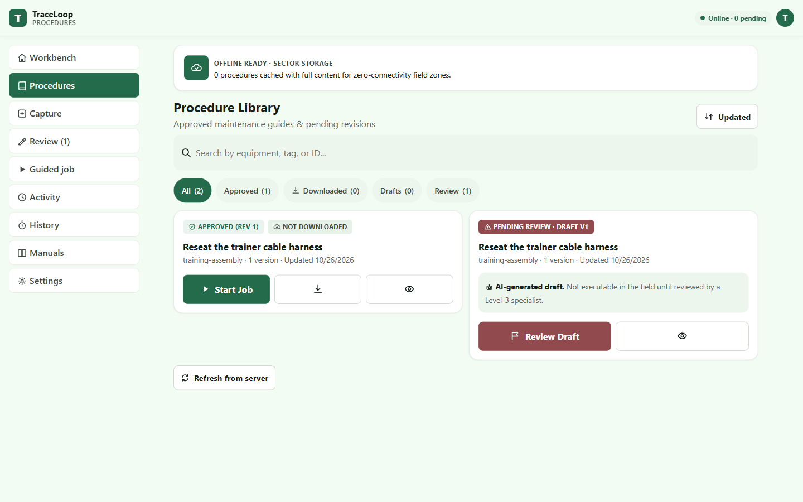

# TraceLoop

### Capture expertise. Keep it working.

**When an experienced employee leaves, their know-how should not leave with them.**

Much of a company's most valuable operational knowledge lives in demonstrations, spoken explanations, and the decisions experienced people make on the job. Traditional manuals are time-consuming to write and can quickly become incomplete or outdated.

**TraceLoop turns a short recording of someone performing a real task into reusable, visual, guided work instructions.** Teams can refine the steps, approve a version, follow the procedure offline, and use feedback from the field to improve the next revision.

**[Try the live application](https://app.knowloop.online/)** · **[Meta Global AI Developer Hackathon](https://dev.meta.ai/events/global-hackathon)**

> **For hackathon judges:** Start with the [live application](https://app.knowloop.online/) and the [five-minute walkthrough](#judge-walkthrough). The three-minute submission video is awaiting owner approval and is not included yet. A local installation is not required to explore the hosted app. The hosted demo may request the shared passphrase `meta`; this is a demo gate, not protection for confidential data. No production credentials are stored here. If the hosted service is unavailable, use the [local setup](#run-locally).

## The problem and the solution

Imagine a technician assembling a machine component. They record their hands working and explain the task aloud. Instead of spending hours writing a manual from scratch, they use TraceLoop to build a procedure from the source recording. A colleague can then follow the approved instructions, record a problem, and help improve the procedure for the next person.

The same workflow works for other physical tasks. TraceLoop is designed around broader knowledge-transfer use cases, particularly hands-on work.

**Business value:** Preserve practical expertise, reduce dependence on individual employees, standardize knowledge transfer, support new team members, and keep instructions useful as practices change. These are product goals, not claims of measured customer savings.

## What TraceLoop does

1. **Capture:** Record a demonstration in the browser or upload MP4, WebM, MOV, or MKV. The original video remains available as source evidence.
2. **Understand:** Meta AI analyzes spoken explanations or sampled visual frames, identifies task details, and proposes structured instructions. Automatic mode selects an appropriate analysis path; Visual-First supports recordings without narration.
3. **Refine:** Tutorial Studio brings together the source, transcript (when speech exists), timed sections, steps, images, object observations, and content history. Experts correct ambiguous details.
4. **Publish:** Generate an **Illustrated Work Instruction**, **Reference Manual**, or **Interactive Guided Execution** guide. The **Video** tab can create a versioned instructional MP4 rendered with Remotion, using source narration when available or captions for silent footage.
5. **Approve:** Submit the canonical procedure for review. Approved revisions are immutable; later changes create new versions rather than silently rewriting prior instructions.
6. **Execute offline:** Save an approved procedure to the device, follow the steps, capture notes and photos, and continue without connectivity. Events synchronize on reconnection.
7. **Improve:** Field feedback can become a Meta AI-assisted improvement proposal, reviewed as a new procedure version. Finished jobs remain linked to the revision they actually used.

~~~mermaid
flowchart LR
  A[Video + optional narration] --> B[Meta AI understanding]
  B --> C[Structured tutorial in Studio]
  C --> D[Guides + optional video guide]
  D --> E[Review + approved revision]
  E --> F[Offline guided execution]
  F --> G[Field feedback]
  G --> H[AI-assisted improvement draft]
  H --> E
~~~

## Judge walkthrough

### Option A — Use the hosted app (recommended)

**Open https://app.knowloop.online/** in a desktop browser. A phone browser also works for the field-execution portion.

Demo roles are selected within the app through **Settings**; they are not separate production-grade user accounts.

For the quickest tour, first explore any existing example tutorials and approved procedures. To experience the whole loop with your own input:

| Step | Where | What to do / what to look for |
| --- | --- | --- |
| 1. Start | **Tutorials** | Choose **Upload an existing video** or record a short, narrated physical task. |
| 2. Select analysis | **Tutorials** | Use **Automatic** for normal input, **Narrated** for clear speech, or **Visual-First** for silent demonstrations. Add a descriptive title, then upload. |
| 3. Examine results | **Tutorial Studio → Overview / Content** | Wait for processing to finish. Inspect the source recording, analysis stages, transcript if speech was detected, and structured steps. |
| 4. Review visuals | **Tutorial Studio → Visuals** | Examine source frames, object overlays or cutouts if generated, and any corrections that require attention. |
| 5. Make a guide | **Tutorial Studio → Guide / Video** | Generate a guide format. Optionally generate and preview the instructional video derived from the same content. |
| 6. Approve | **Review** | Submit the draft. Change the demo role in **Settings** to **Reviewer**, then inspect and approve a version. |
| 7. Use it | **Procedures** | Open the approved procedure, choose **Save for offline use**, and **Start job**. Complete steps or record an issue. |
| 8. Close the loop | **Activity → Review** | Finish the job, submit feedback, create an improvement proposal as Reviewer, compare its changes, and approve a new version. |

**Offline check:** After saving a procedure while online, use your browser's network-offline mode (or a device's airplane mode) and continue the guided job. Reconnect, open **Activity**, and use **Sync now** if needed. Only server-acknowledged events are marked synchronized.

**Suggested sample:** Upload a short recording of a non-sensitive task you are authorized to share. This repository does not bundle a sample recording.

Processing requires network access and can take time. Do not confuse an uploaded file with a finished guide; wait for the tutorial to reach its completed state.

### Option B — Review the code and reproduce locally

Use the [local setup](#run-locally) and the more detailed [demo runbook](docs/demo-runbook.md). For a live Meta AI demonstration, configure a valid server-side Meta Model API key. Without the key, the application offers visibly labelled deterministic fallback results; those are not proof of live model inference.

## How Meta's models power the product

Meta is used for distinct parts of the workflow—not simply a chatbot added to an existing form.

| Meta model | TraceLoop integration | Why it matters |
| --- | --- | --- |
| **Muse Spark 1.3** | Multimodal understanding of sampled source frames and narrated content; structured step and object extraction; procedure drafting; guide generation; instructional-video scene planning; feedback-based improvement proposals. | Converts unstructured observations into actionable, editable knowledge. |
| **Muse Voice Transcribe** | Speech-to-text for genuine narrated recordings, including turn-level timestamps. | Preserves an expert's verbal instructions and helps associate them with the task. |
| **SAM 3.1** | Text-prompted identification and segmentation of task-relevant objects, with boxes, masks and derived overlays/cutouts where a valid match is available. | Connects written instructions to the physical components visible in the recording. |
| **Muse Image** | Optional generation or editing of explanatory visuals, with review and explicit labeling of AI-generated assets. | Helps produce clearer supporting illustrations when source imagery alone is insufficient. |

Live Meta calls run **server-side** through Meta Model API; credentials are not placed in the browser. Individual stages may be skipped when inapplicable (for example, transcription for a silent video) or fail independently. Tutorial Studio exposes stage status and distinguishes live output from simulated fallback. The app does not claim that every model must succeed on every uploaded recording.

**Our key design choice:** Meta's models provide multimodal interpretation and draft assistance; the product's structured content, human corrections, revision history, review controls, offline job state and sync logic turn those outputs into a repeatable team workflow.

Further reading: [Meta Model API](https://dev.meta.ai/docs/overview) · [Architecture](docs/architecture.md) · [Tutorial pipeline](docs/tutorial-mode.md)

## Technical architecture

- **Frontend:** React, TypeScript, Vite, installable Progressive Web App; IndexedDB for offline procedure data and queued actions; service worker for app shell and authorized media caching.
- **Backend:** Python, FastAPI, SQLAlchemy, server-side Meta AI adapters, asynchronous tutorial processing, and media handling.
- **AI and media:** Muse Spark, Muse Voice Transcribe, SAM 3.1, optional Muse Image; ffmpeg processing; Remotion for optional generated instructional videos.
- **Persistence:** SQLite for the single-instance demo; database and uploaded media require persistent volumes when deployed.
- **Deployment:** Multi-stage Docker build serving the API and PWA from one origin; see [Coolify deployment guide](docs/deployment-coolify.md).

## Run locally

Recommended: Python 3.12+, Node.js 22+, npm, and a current Chrome/Chromium-based browser. Run the backend and frontend in **separate terminals**.

### Backend

**macOS / Linux:**

~~~bash
cd backend
python3 -m venv .venv
source .venv/bin/activate
python -m pip install -r requirements.txt
python -m uvicorn app.main:app --reload --port 8000
~~~

**Windows PowerShell:**

~~~powershell
cd backend
py -3.12 -m venv .venv
.\.venv\Scripts\Activate.ps1
python -m pip install -r requirements.txt
python -m uvicorn app.main:app --reload --port 8000
~~~

To enable live Meta inference, configure **META_API_KEY** securely in the backend environment (for example, in an untracked backend/.env file). Do not commit the key or expose it in frontend variables. The application can start without a key in labelled fallback mode.

### Frontend

~~~bash
cd frontend
npm ci
npm run dev
~~~

Open **http://localhost:5173**. The Vite development server proxies API requests to the local backend on port 8000.

### Run checks

~~~bash
# Backend, with its virtual environment active
cd backend
python -m pytest tests -q
~~~

~~~bash
# Frontend
cd frontend
npm run test
npm run build
~~~

No hard-coded historical test-pass counts are used here; run the commands against your current checkout.

### Docker deployment

From the repository root:

~~~bash
docker build -t traceloop:demo .
docker run --rm -p 8000:8000 \
  -v traceloop-db:/data \
  -v traceloop-media:/app/backend/data \
  traceloop:demo
~~~

Then open **http://localhost:8000**. On a real deployment, configure HTTPS, a team passphrase, a signing secret, persistent volumes and a server-side Meta key as appropriate. See the [deployment runbook](docs/deployment-coolify.md) for environment settings.

## Understanding the scope of this demo

TraceLoop is a **hackathon prototype and functional product demonstration**, not a claim of enterprise security certification or measured production ROI. The team-passphrase gate and selectable demo roles are designed for a controlled demonstration, not individual enterprise identity management. Treat data in any shared demo environment as demo data; do not upload confidential company footage.

Features such as speech transcription, object segmentation and generated illustrations depend on the source recording and enabled model services. The silent repository sample demonstrates the visual-first path. Simulation mode is useful for reproducing the workflow without model credentials, but should not be presented as a live Meta result.

## Repository map

| Path | Purpose |
| --- | --- |
| [frontend/](frontend/) | Web PWA, Tutorial Studio, Procedures, offline execution and Activity |
| [backend/](backend/) | FastAPI, Meta adapters, tutorial processing and versioned procedure APIs |
| [video/](video/) | Remotion renderer for versioned in-app instructional videos |
| [docs/video-renderer.md](docs/video-renderer.md) | In-app Remotion renderer architecture and local commands |
| [docs/demo-runbook.md](docs/demo-runbook.md) | Detailed end-to-end judge walkthrough |
| [docs/tutorial-mode.md](docs/tutorial-mode.md) | Video upload, narrated/visual-first processing and Studio workflow |
| [docs/review.md](docs/review.md) | Evidence, tests and known technical constraints |
| [docs/deployment-coolify.md](docs/deployment-coolify.md) | Deployment and persistence checklist |

---

**TraceLoop — Preserve practical know-how. Share it across the team. Keep improving it.**

Built for the [Meta Global AI Developer Hackathon](https://dev.meta.ai/events/global-hackathon) using Meta's multimodal models.
